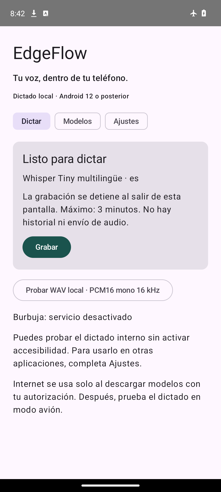

# EdgeFlow Android

Dictado local para Android 12 o posterior: voz → Gemma 4 o Whisper en el teléfono → revisión opcional → texto en el campo original o copia manual. Mantiene el teclado actual.

**Estado: iteración v0.2 en validación. Tiny/Base de v0.1 no alcanzaron calidad útil en la prueba del propietario.** No es un producto listo para Google Play. La UI y el motor son reales; no hay transcripciones simuladas.



## Probar

1. Instala el APK de depuración construido desde este repositorio.
2. En **Modelos**, elige Gemma 4 E2B/E4B para audio directo y revisión, o Tiny/Base como comparación; descarga el modelo desde Hugging Face, sin cuenta ni token. Solo Wi-Fi; descarga e importación son voluntarias.
3. La app verifica tamaño exacto y SHA-256 e instala una copia privada. Conserva el original en `Descargas/EdgeFlow` para recuperarlo mediante **Importar** tras reinstalar.
4. En **Dictar**, pulsa **Grabar**, acepta micrófono, habla y pulsa **Detener y transcribir**. También puedes importar un WAV PCM16 mono a 16 kHz de hasta 180 s.
5. Para otras apps, lee y acepta la divulgación en **Ajustes** y activa EdgeFlow en Accesibilidad. Enfoca un campo: aparece una burbuja arrastrable. Ábrela, graba y usa **Volver e insertar**. Si el destino no puede comprobarse, copia y pega manualmente.
6. Activa modo avión después de instalar los modelos y repite el dictado.

No se pulsa Enviar. Una selección de texto no vacía utiliza respaldo manual para evitar borrarla. No se activa sobre campos de contraseña identificables. No hay historial, nube ni telemetría. La grabación ocurre en pantalla visible y se cancela al salir; la inferencia empieza después de detenerla.

## Compilar

Requisitos: JDK 17, SDK 36, NDK `30.0.15729638`, CMake `4.1.2`. Android Studio puede instalar estos componentes. Se generan bibliotecas `arm64-v8a` para el Xiaomi y `x86_64` para emulador, con soporte de páginas de 16 KB mediante NDK moderno.

```bash
git clone --recurse-submodules https://github.com/256javy/edgeflow.git
cd edgeflow
# Si ya lo clonaste sin submódulos:
git submodule update --init --recursive
export ANDROID_HOME="$HOME/Android/Sdk"
./gradlew :app:testDebugUnitTest :app:lintDebug :app:assembleDebug
adb install -r app/build/outputs/apk/debug/app-debug.apk
```

El wrapper fija Gradle 9.4.1 con checksum. AGP 9.2.1 integra Kotlin; Compose compiler 2.3.10. Las versiones están declaradas en Gradle. El submódulo fija Whisper.cpp v1.8.7 por SHA.

## Qué incluye la v0.2

- Compose Material 3, Gemma 4 E2B/E4B con audio directo y revisión local (LiteRT-LM 0.13.1), Tiny/Base como comparación, español/inglés/automático.
- AudioRecord PCM16 mono 16 kHz, límite de 180 s, nivel y duración; inferencia CPU fuera del hilo principal, cancelación cooperativa y latencia local.
- DownloadManager con progreso, cancelación y recuperación de descarga tras muerte del proceso; verificación SHA-256 y SAF para recuperar archivos.
- Burbuja de accesibilidad con tamaño, opacidad, posición persistente y exclusión por paquete. No requiere cambiar Gboard ni permiso SYSTEM_ALERT_WINDOW.
- Inserción conservadora validando nodo, foco y cursor; resultado conservado solo en RAM para respaldo.
- Tests de inserción, contraseñas, WAV corrupto y prueba nativa Android con audio sintético.

## Diccionario y revisión

En Ajustes puedes introducir hasta 80 términos o correcciones, una entrada por línea:

```text
PostgreSQL
GitHub
DNIT
posgres => PostgreSQL
```

Los términos se usan como contexto de reconocimiento. Solo las reglas explícitas producen sustituciones de palabra completa; no se adivinan alias. No se modifican pesos ni se necesita entrenar un modelo por usuario. El diccionario se conserva entre aperturas y actualizaciones con la misma firma; se elimina al desinstalar. Todavía no hay exportación del diccionario.

Activa **Proponer revisión después del dictado** y selecciona un Gemma instalado para revisar puntuación y redacción localmente. Se muestran original y propuesta: elige **Usar propuesta** antes de copiar o insertar. El original sigue disponible; la propuesta puede equivocarse. Se rechazan cambios de cifras o negaciones y resultados desproporcionados, sin afirmar que esto verifica todo el significado.

## Límites y siguientes pasos

La burbuja abre una actividad visible y pide pulsar Grabar. La posición inicial es fija y arrastrable, sin ajuste automático al teclado. La captura se cancela al pausar la actividad. No hay IME alternativo, entrenamiento acústico ni conservación de voz personal.

Cada entrada de audio de Gemma admite hasta 30 s; se usan fragmentos de 25 s con 1 s de solapamiento hasta un total de tres minutos. El solapamiento se combina por coincidencia textual de borde: puede dejar repeticiones o perder calidad en cortes. La revisión no recupera con certeza palabras mal reconocidas.

Gemma solicita GPU para el decoder y CPU para el encoder de audio; si GPU no inicializa, se usa CPU y se muestra el backend real. Qwen3-ASR/LiteRT y NPU no están integrados. No se confunde el runtime generativo LiteRT-LM con el ASR general LiteRT.

La calidad del español del propietario y las apps reales requieren aceptación manual. Consulta [investigación](docs/research.md), [pruebas](docs/testing.md), [arquitectura](docs/architecture.md) y [validación](docs/validation-v0.2.md).

## Open source

Código propio bajo [MIT](LICENSE). Revisa [contribución](CONTRIBUTING.md), [seguridad](SECURITY.md) y [atribuciones](THIRD_PARTY_NOTICES.md). Los pesos se descargan por separado y conservan su propia licencia.
